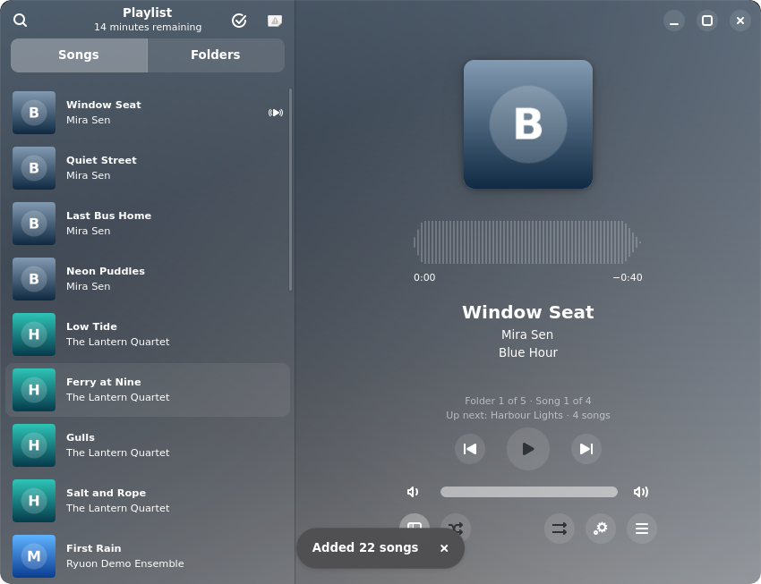
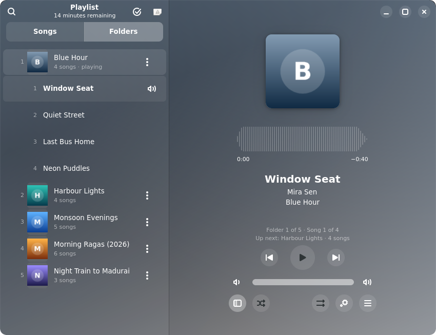
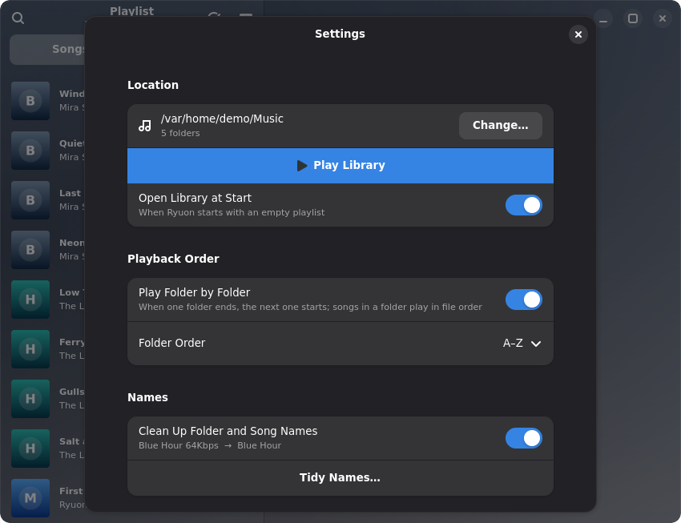
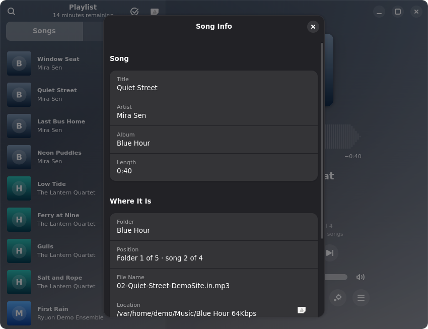
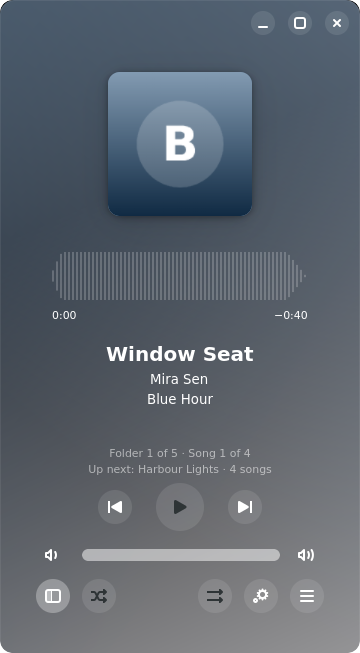

<!--
SPDX-FileCopyrightText: 2026  Harish
SPDX-License-Identifier: GPL-3.0-or-later
-->

# Ryuon


**A music player for people who keep their music in folders.** Choose your music folder once,
and Ryuon plays it one folder after another, picking up where you stopped the next time.

- **Folder by folder:** "Folder 7 of 139 · Song 4 of 10", and what plays next
- **Resume:** reopens on the song and second where you stopped
- **Reorder:** play next, move songs or whole folders, undo
- **Sort folders:** by name, newest, most songs, recently played, or your own order
- **Folders view:** every album with its cover and song count; finished ones ticked, the playing
  one opened to its songs
- **Song Info:** right-click a song to see which folder and file it comes from, its format and size
- **Tidy names:** hides site tags, bitrates and underscores on screen
  (`Coolie-320kbps-MassTamilan` shows as `Coolie`); your files stay as they are
- **Tidy Names (optional):** preview every before → after name, then change only how they look or
  rename the files on disk, with full undo
- Album-art colours, media keys and desktop media controls, phone-sized layout

Ryuon runs on Linux (64-bit PCs, desktop and phone layouts) as a Flatpak. A Windows beta is
planned: see [windows/ROADMAP.md](windows/ROADMAP.md).

## Screenshots

| Playing, folder by folder | Folders view |
|---|---|
|  |  |

| Settings | Song Info |
|---|---|
|  |  |

| On a phone |
|---|
|  |

The window takes its colours from the album art. The screenshots use a generated demo library
(`tools/make_demo_library.py`), not real albums.

## Install

1. **Set up Flatpak** if you have not: see [flathub.org/setup](https://flathub.org/setup) for your
   distribution. Linux Mint, Fedora and Pop!_OS already have it.
2. **Download** `Ryuon-0.2.0.flatpak` from the
   [latest release](https://github.com/K-S-Harish-Balagi/ryuon/releases/latest).
3. **Install** it: double-click the file to open it in your software centre, or run

   ```sh
   flatpak install --user Ryuon-0.2.0.flatpak
   ```

   Flatpak downloads the GNOME runtime from Flathub the first time (about 400 MB).
4. **Open Ryuon** from your applications menu, or run `flatpak run io.github.k_s_harish_balagi.Ryuon`.

To update, download the new release and install it the same way. To remove it:
`flatpak uninstall io.github.k_s_harish_balagi.Ryuon`.

## First steps

1. Open the main menu (☰) and choose **Choose Music Library…**, then pick the folder that holds
   your album folders.
2. Choose **Open Library** (Ctrl+O). Ryuon queues everything folder by folder and starts with
   the first.
3. Turn on **Open Library at Start** in **Settings** (the gear button, or Ctrl+,) so it is ready
   every time.

**Is your music outside your Music folder** (another drive, a NAS)? Ryuon can only see your
Music folder until you allow more. Run this once, with your own path, then restart Ryuon:

```sh
flatpak override --user --filesystem=/path/to/Music:ro io.github.k_s_harish_balagi.Ryuon
```

## Everyday use

| To | Do this |
|---|---|
| Play a song next, move it, or remove it | Right-click it (or long-press, or Menu key), or drag it |
| Move a whole folder | Right-click a song in it: Play This Folder Next, Move Folder Up or Down |
| Undo a move | Click **Undo** on the message that appears |
| Move with the keyboard | Alt+Up/Down moves a song, Alt+Shift+Up/Down its folder |
| See all folders | The **Folders** tab above the playlist, or Ctrl+G |
| See where a song comes from | Right-click it › **Song Info** (Menu ☰ › Song Info for the playing song) |
| Change the folder order | The sort button above the playlist › Sort Folders By |
| Go back to normal order | The sort button › Reset to Folder Order |
| Change the library folder | Settings (gear button) › Location › Change… |
| Show the real file names | Settings › Names: turn off **Clean Up Folder and Song Names** |
| All keyboard shortcuts | Menu ☰ › Keyboard Shortcuts |

## Renaming files on disk (optional)

**Tidy Names…** (Menu ☰, or Settings › Names) lists every name before and after, and marks
two that would end up the same. Choose **Only change how they look** to leave the files alone,
or **Rename the files on disk** to give your files and folders their tidy names: it asks you to
type the number of changes first. Nothing is deleted or overwritten: a name
that is already taken gets "(2)" added. **Undo Rename** puts every name back, and a record of
each rename is kept so this works even after a crash.

Ryuon needs permission to change the folder. Run this once, then restart Ryuon:

```sh
flatpak override --user --filesystem=/path/to/Music io.github.k_s_harish_balagi.Ryuon
```

Before renaming, check that nothing else depends on the current names, for example playlists
in other players or a media server that tracks files by path.

## Reporting problems

Open an [issue](https://github.com/K-S-Harish-Balagi/ryuon/issues) with what you did, what you
expected and what happened. Output from `flatpak run io.github.k_s_harish_balagi.Ryuon` in a
terminal helps.

## Build from source (developers only)

You do **not** need this to use Ryuon: the release file above is all a user needs. Building is
for changing the code. You need `flatpak`, `flatpak-builder` and the Flathub remote.

```sh
git clone https://github.com/K-S-Harish-Balagi/ryuon.git
cd ryuon
flatpak install --user flathub org.gnome.Sdk//51 org.freedesktop.Sdk.Extension.rust-stable//26.08
flatpak-builder --user --install --force-clean build-dir io.github.k_s_harish_balagi.Ryuon.json
flatpak run io.github.k_s_harish_balagi.Ryuon
```

The build is offline: all Rust crates are listed in `cargo-sources.json` (regenerate it with
[flatpak-cargo-generator](https://github.com/flatpak/flatpak-builder-tools/tree/master/cargo)
after changing dependencies). Development tools and tests are described in
[`tools/README.md`](tools/README.md); `tools/make_demo_library.py` makes a small copyright-free
library to try things with.

## How it was made

Ryuon's own features (library, reordering, tidy names, renaming, sorting, Folders view,
Song Info, Settings, about 3,000 lines of Rust and the tests in `tools/`) were written with the help of
an AI coding assistant, Claude by Anthropic, directed and reviewed by the maintainer.

## Licence and credit

GPL-3.0-or-later, see `LICENSES/`. The name, logo and icons are original artwork for this
project. Ryuon is a modified version of [Amberol](https://gitlab.gnome.org/World/amberol) by
Emmanuele Bassi and contributors, whose code keeps its copyright (history in `CHANGES.md`).
